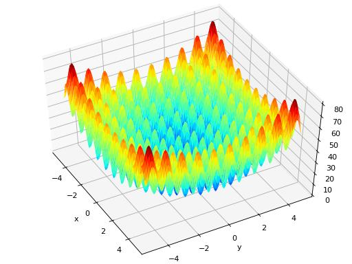

### Run Instructions
- Download `rastrigin.py` and `requirements.txt`
- In terminal, run `pip install -r requirements.txt`
- Then to run, `python rastrigin.py`

---
# Rastrigin Function Optimiser

The Rastrigin function is a function widely used to benchmark optimisation algorithms, due to its highly multimodal nature. At a point in $n$-dimensional space given by $x=(x_1, x_2, ... x_n)$, 
$$
f(x) = An + \sum_{i=1}^{n} \left[ x_i^2 - A \cos(2\pi x_i) \right]
$$

Its minimum value is at $f((0, 0, ..., 0)) = 0$, but it is filled with surrounding valleys that have almost equally small minima, each very hard to distinguish from the global minimum. This problem is only exacerbated as $n$, the number of dimensions, increases - with a larger $n$, there are more directions to step in, and exponentially more local minima to end up trapped in.

It is conventional to use a domain of $-5.12 \le x_i \le 5.12$, which is what I chose for my implementation.

My code in `rastrigin.py` makes use of two optimising algorithms:

---
## Simulated Annealing

This is an optimising approach which is derived from the physical process of annealing, and much of the terminology used relates to annealing. Annealing is the process of heating a material to a high temperature, and then gradually cooling it so that its atoms arrange themselves in a more stable manner. If it cools too fast, atoms are essentially 'frozen' in their random, generally unstable, positions. By cooling slowly, you allow the atoms time to gradually move towards their stable positions, resulting in a stronger material.

Simulated annealing works the same way. The algorithm starts with a high 'temperature', which lets it wander around almost randomly. Each move is picked in a uniform $n$-ball of radius $\delta$, and if it leaves the domain, it is reflected back inside. The temperature is then gradually cooled, which can be thought of as the algorithm being pulled downhill (with respect to $f(x)$) more and more - it will increasingly only accept moves which minimise the function. Once it is sufficiently cool, the algorithm will halt, with the hope that this very gradual cooling schedule has allowed it to move freely enough so that it has ended up at the global minimum. Using a logarithmic cooling schedule, as cooling time approaches infinity, the probability that the algorithm finds and ends up at the global minimum approaches 1 - this means that for an implementation of SA with an unbounded cooling time, the algorithm would *always* halt at the global minimum. This fact specifically is what drew me to the algorithm - with enough compute, it is *always* possible to determine the global minimum to an arbitrary degree of certainty. 

In my implementation, the chance that a move (where $T$ = temperature and $\Delta E$ = the change in the objective function) is accepted is given by:

$P(\text{accept}) = \begin{cases} 1 & \Delta E < 0\\ e^{-\Delta E/T} & \Delta E \geq 0 \end{cases}$

If $\Delta E$ < 0: The move improves the function - accept it always
If $\Delta E \ge 0$: The move does not improve the function - accept it with $P(\text{accept}) = e^{-\Delta E/T}$

Rearranging this relationship for $T$, we see that $T = \frac{-\Delta E}{ln(P(accept))}$.

To initialise temperature, my implementation uses this relationship to find a value for $T$ that will ensure a certain fraction (e.g. $\approx 95\%$) of uphill moves are initially accepted.  (To get a value for $\Delta E$, it generates a number of moves from the starting position, and takes the arithmetic mean of the $\Delta E$s of only the uphill ones)

The algorithm then begins a loop, of generating moves, accepting all downhill ones, and accepting the uphill ones according to $P(accept)$. At the end of this loop it multiplies the temperature by a cooling factor ($\approx 0.999$), to gradually start accepting fewer uphill moves. 

It continues this loop until $\le 1\%$ of the last 1000 moves have been accepted, where it halts. We now hope that the algorithm at some point travelled into the minimal valley, and if it has, it reached a low enough value of the objective function that it has been recorded as the lowest point found. Due to the $\delta$ being fixed however, even if it has found the minimal valley, it is unlikely that these large $\delta$-sized steps would have brought it to the exact minimum of $f(x) = 0$ at $x = (0, 0, ..., 0)$. This is where the other algorithm in this hybrid approach comes in.

---
## Gradient Descent

Gradient descent is arguably the simplest optimising algorithm possible. It is entirely greedy - it works by calculating the gradient at a point (direction of steepest ascent), and then taking a step in the *opposite* direction. As with most greedy algorithms, it is incredibly simple to implement and very efficient, but ultimately short-sighted for a problem like this. The Rastrigin function exposes gradient descent's glaring weakness - it will always optimise for a local minimum, and leaves it down to pure chance that this happens to be the global one. In this way, it has a very low success rate when run from a random point in this domain due to the number of local minima.

However, this is where the hybrid approach comes in: we first use SA in hope to find a point which is inside the globally minimum valley. Now taking this point, we use GD with a dynamically decreasing step size ($\delta$) to refine this point to the valley's actual minimum. This combination of a tentative exploratory algorithm to first identify the most promising valley, followed by a greedy optimiser to find that valley's exact minimum is highly effective.

My implementation of GD is simple - it begins with a $\delta$ of moderate size - large enough to make progress, but not large enough to accidentally leave the current valley. It begins at the lowest point identified by SA, and then uses the derivative of the Rastrigin function at that point to calculate the gradient. Negating and normalising this gradient gives a vector in the direction of steepest descent, and the algorithm then takes a $\delta$-sized step in this direction. If this reduces the function, it accepts the move and repeats. If it instead increases the function, the step must have been long enough for the gradient in that direction to become positive, and so $\delta$ is too large. Thus, $\delta$ is divided by 2.5, and the move is rejected. 

This loop continues until $\delta$ reaches an arbitrarily low value, in which case a minimum has been reached.

---
## Methodology

I experimented with many different approaches and parameters for this problem, but the ones in `rastrigin.py` are the most effective I have found. Some findings:

- The cooling schedule I used, of multiplying $T$ by some constant every iteration (geometric/exponential), is only one approach I tried. It is also possible to have an arithmetic cooling schedule, where $T$ is reduced by a fixed $\Delta T$ every iteration, or a dynamic cooling schedule, which cools and reheats dependent on acceptance rates. I found both of these approaches less effective than the simple geometric one I ended up using.
- I initially only planned to implement SA until I found that the algorithm was returning points inside the global minimum valley, but struggling to reach the exact optimum due to the imprecise method of taking $\text{0 to }\delta$-sized steps. I first attempted to implement a dynamic $\delta$ that was reduced once a certain low acceptance rate was achieved, but this approach was ineffective - it ended up behaving too greedily, trapping itself in the local minima.
- The SA halting condition was originally implemented as a minimum threshold temperature, however I found the minimum acceptance rate to be a more effective proxy than an arbitrary constant.
- My implementation needs surprisingly slow cooling to be effective. It seems that a typical geometric cooling schedule might use a coefficient like 0.997, and this is what I initially tried but to not much avail. I found that a value like 0.99999 was far more effective for my algorithm, at the cost of a slower runtime.
- This optimisation problem becomes exponentially harder as $n$ (dimensions) increases. I first implemented it in 2D, and scaled it up to 3- and 4-dimensional runs, which were broadly successful. Each added dimension presents its own issues - one I found particularly trying was that as $n$ increases for a fixed $\delta$, the effective 'size' of that step in each dimension is reduced. This may seem unintuitive, but it becomes obvious when you realise that the same $\delta$ is distributed over more dimensions of travel, so there is a smaller step in each dimension. Because of this, the parameters had to be tuned individually for each $n$. I did find a set of values which was successful in optimising the 5-dimensional function, but the runtime was too long to generate any meaningful data - this seems to be the limit of my algorithm. Thus, my data is gathered from runs where $n \le 4$.

---
## Findings

Running with $n$ = 2, 3, and 4, we see:

| Dimensions | SA Average Iterations | SA Average Runtime (s) | GD Average Iterations | GD Average Runtime (s) | Average f(x) | Success rate (%) |
| ---------- | --------------------- | ---------------------- | --------------------- | ---------------------- | ------------ | ---------------- |
| 2          | 693,140               | 6                      | 18                    | 0.000                  | 0.199        | 98               |
| 3          | 612,440               | 8                      | 19                    | 0.000                  | 0.000        | 100              |
| 4          | 571,260               | 7                      | 19                    | 0.000                  | 0.438        | 57               |

We can see that this algorithm is effective - it usually succeeds in finding the global minimum, especially in the lower dimensions. The most obvious conclusion is that the success rate is heavily dependent on $n$. We can see that it is approximately 100% for 2- and 3-dimensional runs, but drops to 57% once $n=4$. The runtimes and iteration figures remain relatively constant between dimensions, as the cooling schedule is constant across all of them.

---
## Limitations and Future Improvements

#### Limitations:
- The geometric cooling schedule I used does not guarantee convergence to the global optimum - only a sufficiently slow logarithmic cooling schedule can guarantee convergence under some assumptions. Because of this, my algorithm could never be made to be 100% accurate for an arbitrary value $n$. 
- Parameter tuning is required for changes in $n$ - due to the effects mentioned above, $\delta$ should be modified dependent on $n$ to preserve the same absolute change in each dimension per step. This could be an explanation for why the 2D run had a slightly *lower* success rate than the 3D one.
#### Future Improvements:
- Adaptive step sizes - having $\delta$ adapt to the current state would improve the precision of the algorithm, and possibly eliminate the need for GD altogether.
- Alternate cooling schedules - implementing multiple cooling schedules at the same time, and running tests to compare them across an equal number of iterations.
